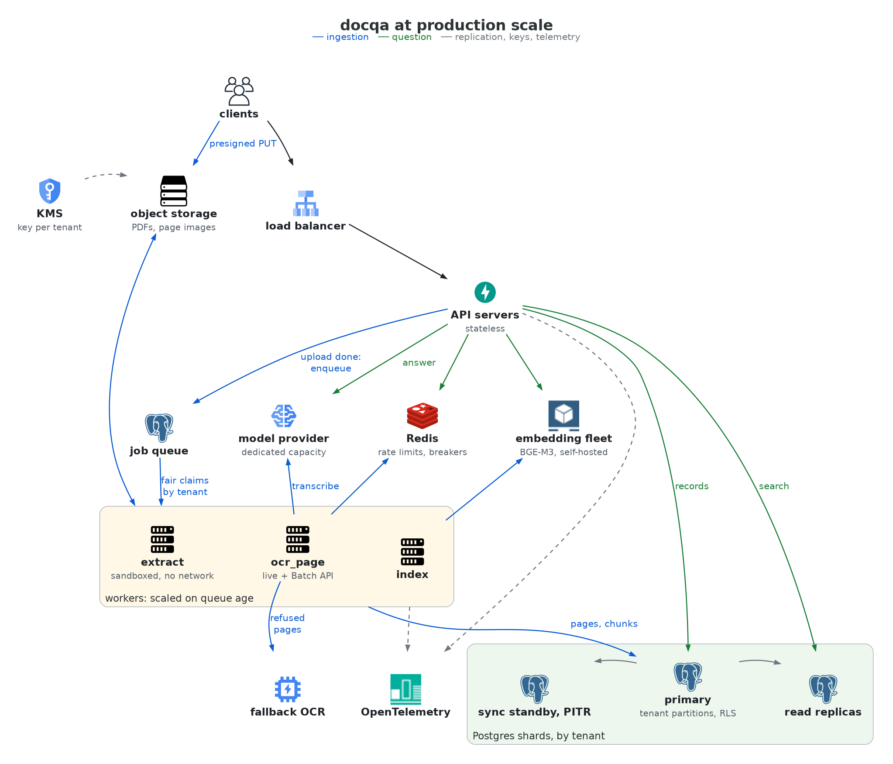

# Design: from the MVP to production scale

Scenario: 2,000 tenants; about 40,000 PDFs a day (5 to 500 pages, about 15% scanned or broken), in bursts
when a customer onboards a plant; questions peaking at about 300 per second, with a p95 under 4 s.

**(m)** marks numbers measured on this MVP: the eval report (`eval/REPORT.md`, 73 questions, answer model
`gemini-3.8-flash`), a run on 10 external manuals, and the build measurements in `DECISIONS.md`.
**(e)** marks estimates built from the assumptions in section 2.

## 1. What is missing, in priority order

Blockers first, then the failure we can't undo, then the target the requirements set, then cost and quality
at volume, then features.

| # | Missing | Why at this rank |
|---|---|---|
| 1 | **Run on many machines:** stateless API and workers, object storage with presigned uploads, page images as a stored artifact, the queue in its own database. | The API and the worker share a local volume on one host (decision 4). Nothing else runs at scale without this. |
| 2 | **Isolation in depth:** Row-Level Security, tables partitioned by tenant, a KMS key per tenant, tenant deletion, cross-tenant cache hits hidden. | A leak can't be taken back, and partitioning gets more expensive with every day of data. It must land before the second customer. |
| 3 | **Provider capacity and the latency tail:** dedicated throughput, a global rate limiter, hedged requests, shorter ambiguous answers. | p95 is 8.7 s **(m)** against 4 s, and the peak needs 27 times our input-token quota **(e)**. |
| 4 | **Ingestion under bursts:** claims balanced by tenant, an onboarding lane on the Batch API, parallel extraction, cancellation, a negative OCR cache. | The queue is FIFO with one extraction at a time: 10 manuals took 861 s **(m)**. One onboarding would delay every tenant. |
| 5 | **A quality loop:** feedback endpoint, sampled human review, a validated judge, an eval gate on every model, prompt or index change, retrieval tuned for large corpora. | Retrieval tuned on the 4 sample manuals reaches an MRR of 0.89 there and 0.43 on 10 external ones **(m)** (decision 10). The misses became `not_found`, never unsafe answers (0 of 15), so it ranks after safety and capacity. |
| 6 | **Data residency:** per tenant, an external model, a regional endpoint, or self-hosted models. | Some customers will require it; models are already set by variables behind one gateway. |
| 7 | **Features:** quote highlighted on the page, conversation and document tools, translation on demand, grouping translations and near-duplicates. | None makes an answer safer or holds the load. |

Not engineering, but a precondition: PyMuPDF is AGPL, so a hosted service needs a commercial license or
another extractor.

## 2. Assumptions and arithmetic

| ID | Assumption | Value | Basis |
|---|---|---|---|
| A1 | Pages per PDF | 80 | Our samples average 43 (4 manuals) and 123 (10 external) |
| A2 | Peak over mean question rate | 10 | Assumed; questions follow plant shifts |
| A3 | Manuals repeated across tenants | 0 in costs | An upside only: OCR is cached by content |
| A4 | Pages needing OCR | 20% | 15% scanned or broken, plus 5% of the rest (drawing and code pages: 55 of 1,123 in the external manuals) |
| A5 | Time until searchable | Minutes for one upload, same day for an onboarding batch | Our target; the requirements set none |
| A6 | Repeated questions | Unknown | Measure from traffic before building an answer cache |
| A7 | PDF size | 5 MB | |

| Quantity | Arithmetic | Result |
|---|---|---|
| Pages | 40,000 × 80 | 3.2 M a day, 37 a second |
| Pages to transcribe | 3.2 M × 20% | 640 k a day, 7.4 a second |
| Chunks | 3.2 M × 3 (2.5–3.2 per page **(m)**) | 9.6 M a day, 111 a second |
| Questions | 300 ÷ 10 × 86,400 | 2.6 M a day |
| Input tokens at the peak | 300 × 3,030 per question **(m)** | 55 M a minute |
| Model calls in flight at the peak | 300 × 2.9 s **(m)** | about 900 |
| Original files | 40,000 × 5 MB | 200 GB a day, 73 TB a year |
| Chunks in Postgres | 9.6 M × 11 KB (MVP schema **(m)**) | 110 GB a day, 40 TB a year |
| Answer records | 2.6 M × 22 KB (record, candidates, spans **(m)**) | 57 GB a day |

Our Tier 1 quota for the answer model is 1,000 requests and 2 M input tokens a minute; the peak needs 18,000
and 55 M. Dedicated capacity is a requirement, not an optimization.

## 3. Architecture at scale

The pipeline stays the MVP's (README): the page is the record, OCR and indexing run per page, every answer
is verified and recorded. What changes is where state lives and how work spreads.

- **Front door.** Stateless API servers behind a load balancer; any instance serves any tenant.
- **Tenant to shard.** A small directory maps each tenant to its Postgres cluster; API servers and workers
  cache it.
- **The queue in its own database.** The MVP commits a document and its first job in one transaction
  (decision 2). With the queue apart from the shards, that needs an outbox: the API writes the job to an
  outbox table in the tenant's shard, in the document's transaction, and a relay moves it to the queue. The
  periodic reconciliation also catches a document left without a job.
- **Two embedding pools.** One sized for question latency (section 5), one for indexing throughput (section
  4), so an onboarding can't move the answer p95.

## 4. Ingestion at scale

- **Upload.** Three steps for the client: the API returns a presigned URL per file, the client puts the file
  straight into object storage, then confirms, and the API records the document and queues its `extract` job
  (through the outbox). Hashing, magic-byte checks and duplicate detection move to a worker (decision 4); a
  100 MB catalog never passes through the API.
- **Extraction.** 0.3–0.4 s per page for most manuals, up to 1.5 s for table-heavy ones **(m)**: about 15
  processes busy on average **(e)**, ten times more in onboarding peaks, scaled on queue age. Catalogs over
  about 100 pages are split into page ranges, so one slow page can't fail a whole document.
- **OCR.** 7.4 pages a second at 2.8 s per call **(m)** keeps about 21 calls in flight **(e)**. Single
  uploads use the live API; onboarding batches use the Batch API, at half the price within a day (A5). A
  token bucket per model in Redis replaces the MVP's pacing row; its pauses on quota, billing and rejected
  keys stay. The content cache makes vendor manuals repeated across plants free (A3), and a negative cache
  with an expiry stops paying for the same refusals.
- **Recitation refusals.** Both models refused 36 of 60 pages of a public-domain scan **(m)**. Refused pages
  go to an OCR without that filter, a self-hosted Gemma 4 12B **(m, 4 pages on one 16 GB GPU)** or Document
  AI, chosen by a labelled comparison.
- **Indexing.** 133 ms per chunk on an 8-core CPU **(m)**: 111 chunks a second need about 15 such machines
  **(e)**, or a few GPUs (not measured). The embedder stays in-house: the corpus never leaves, and a question
  embeds in 17–22 ms against 431 ms through the provider **(m)**.
- **Fairness.** A claim picks the tenant with the fewest running jobs, under a per-tenant cap, and single
  uploads go ahead of bulk batches. One onboarding of 2,000 PDFs can't starve the others.
- **Storage.** Partitions by tenant give each tenant its own vector index: a filtered search stops losing
  results (decision 3), and the index grows with the tenant (1.75 M chunks for an average tenant after a
  year **(e)**), not with the platform. Vectors move to 16-bit `halfvec`. Tenants spread over several
  Postgres clusters, each small enough to restore within the recovery target.

## 5. Answer path and the p95

Everything except the model call takes 38 ms at the median, 79 ms at most **(m)**: question embedding 22 ms,
search 8 ms, verifier 0.2 ms, record 3 ms. The p95 is the model call.

| Answer model | p50 | p90 / p95 | Max | Over 4 s |
|---|---|---|---|---|
| Flash, eval, 73 questions **(m)** | 2.9 s | p95 8.7 s | 19.7 s | 18 of 73 |
| Flash Lite, design set, 18 questions **(m)** | 1.3 s | p90 1.8 s | 4.0 s | 0 of 18 |

The tail has two measured causes:
- **Queueing at the provider.** Answers of 78 and 98 output tokens took 18–20 s; four of under 60 tokens
  took 6–8 s. Without the ambiguous answers, the p95 is still 8.3 s.
- **Long outputs.** Ambiguous answers run 520 output tokens and 5.8 s at the median; one spent 730 tokens
  thinking.

What we would do, in order:
1. **Dedicated capacity** (provisioned throughput or a negotiated quota). The peak needs it anyway, and it
   removes the shared queue, the larger cause. The first thing to load-test.
2. **Hedged requests:** past the dedicated tier's own p95, send a duplicate and keep the first answer. That
   adds about 5% of calls.
3. **Shorter outputs:** a lower output cap for `ambiguous`,
   thinking off wherever the eval shows no loss.
4. **Routing** to Flash Lite, twice as fast and 2.5 times cheaper, only on a validated signal that a question
   is simple: it picks a case silently on ambiguous questions (decision 18).
5. **An exact answer cache per tenant,** keyed by the normalized question and the corpus, prompt and model
   versions, never filled on incomplete coverage. Never semantic: "frame 256 at 1800 RPM" and "at 3600 RPM"
   embed almost alike and have different answers. A6 decides if it pays.

Streaming wouldn't help: the verifier needs the whole output before anything is returned. At the peak,
question embeddings need 3–6 eight-core machines **(e, from 17 ms on 8 threads, 31 ms on 2)**, and vector
search runs on read replicas of each shard.

## 6. Reliability

- **Provider outage.** Search is local, so a question still gets a 503 with the three most relevant
  passages **(m)**. A circuit breaker per model, shared through Redis, fails fast instead of piling up 900
  calls. A second provider is an option for tenants who accept one more data processor.
- **Jobs.** Leases, fencing tokens and a text revision per page already make every job safe to run twice
  (decision 5). In its own Postgres, the queue's 8 jobs a second on average and 120 in bursts **(e)** are
  well within `SKIP LOCKED` queues; a managed broker only if vacuum pressure shows.
- **Data.** A synchronous replica and point-in-time recovery per shard, and for the queue database. Partitions make a tenant's restore,
  export or deletion local.
- **Changes.** Pages record their extraction, OCR and index versions, so a new chunker or embedding model
  reindexes tenant by tenant, without new OCR, while the old index serves. The MVP reconciles all tenants at
  once.
- **Observability.** The same spans go to an OpenTelemetry collector we host, sampled; answer records stay
  in Postgres for 30 to 90 days. Alerts on answer p95, errors by code, queue age per lane, time until
  searchable, provider pauses, and the unsafe rate from sampled review.

## 7. Cost

| Line | Unit cost | Per day **(e)** |
|---|---|---|
| Answers, Flash | $0.0032 per question **(m)** | 2.6 M × $0.0032 = $8.3k |
| Answers, Flash Lite | $0.0013 per question **(m)** | 2.6 M × $0.0013 = $3.4k |
| OCR, Flash Lite | $0.0022 per dense scanned page, $0.0013 per other page **(m)** | 480 k × $0.0022 + 160 k × $0.0013 = $1.3k; $0.65k on the Batch API |
| Embeddings | self-hosted fleet (sections 4, 5) | not priced here |
| Original files | about $0.023 per GB-month, list price **(e)** | $1.7k a month after one year, less once they move to an infrequent-access class after ingestion |

Answers are about 87% of the model bill. Levers, in order: routing (each 10% of questions moved to Flash
Lite saves about $500 a day **(e)**), the Batch API for onboarding OCR, the cross-tenant OCR cache (A3),
skipping drawing pages, then the answer cache if A6 justifies it. Spans already record tokens per tenant,
which quotas and pricing need.

## 8. Security

- **Isolation in depth.** Today: `tenant_id` on every row, one data-access layer that requires it, an
  isolation test, API keys stored as hashes, the same 404 for another tenant's document and a missing one.
  Next: Row-Level Security with the tenant set per transaction, so a forgotten filter returns nothing;
  partitions; keys scoped to uploading or asking; user identity per tenant (OIDC).
- **Encryption and deletion.** A KMS key per tenant for originals, page images and tenant exports: destroying
  it makes those files unreadable at once. Postgres backups are per cluster, under the cluster's key, so a
  deleted tenant's rows leave the backups when the point-in-time window expires. Tenant deletion covers rows, chunk history, answer records
  and cache references.
- **What leaves.** The provider receives each question's retrieved passages and the flagged page images,
  nothing else. On the paid tier its terms exclude training on prompts; the free tier is never used with
  customer data. A tenant's policy picks external, regional or self-hosted models (self-hosted OCR is
  measured; a self-hosted answer model isn't).
- **The shared OCR cache.** Only identical bytes, hashed by us, reach an entry. But `pages_from_cache` tells
  a tenant that someone else uploaded the same file: the count leaves the tenant's API for telemetry, and
  tenants with confidential documents can opt out.
- **Prompt injection.** Instructions planted on the answering page were obeyed 0 of 4 times in the prototype
  and 0 of 3 through the API **(m, small samples)**. The defenses are structural: the model has no tools or
  authority, cites only the request's labels, and the quote shown is our stored text. A planted value inside
  a cited unit still passes the verifier. Next: flag instruction-like text at ingestion.
- **Hostile PDFs.** Today: a child process per document with time, stall and memory limits, and no secrets
  in its environment (decision 22). Next: a separate pool without network, under gVisor or Firecracker.
- **Secrets.** Provider keys in a secret manager. Spans and logs already exclude keys, question text, page
  text and file names.
